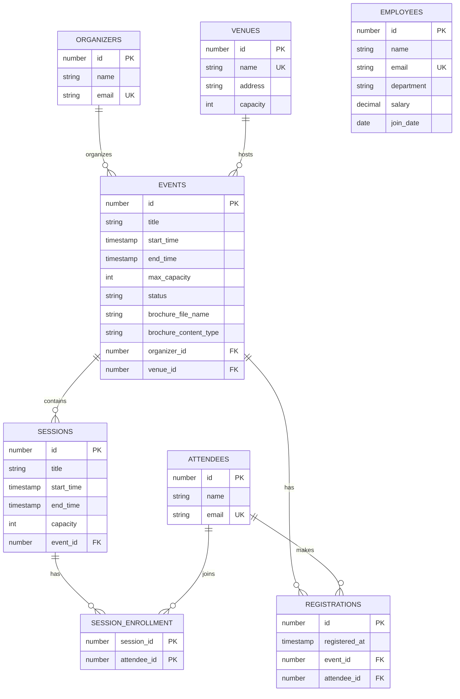

# Entity Relationship Diagram

GitHub renders this diagram automatically. Take the screenshot from the rendered page.

Unique constraints: organizers.email, attendees.email, employees.email, venues.name,
events(venue_id, start_time), registrations(event_id, attendee_id), session_enrollment(session_id, attendee_id).
